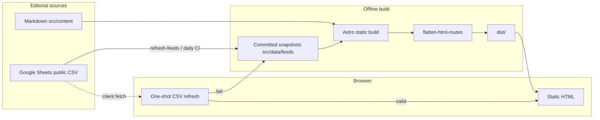

# Technical architecture

Production implementation of the School of Tomorrow’s AI institutional website.

- **URL:** https://schoolai.linalopes.info/  
- **Branch:** `main`  
- **Astro cutover:** `v2.0.0`  
- **Institutional baseline:** `v2.1.0`  
- **Publications & legacy consolidation:** prepared as `v2.2.0` (GitHub release pending owner publication)

## Stack

| Layer | Choice |
|---|---|
| Framework | Astro **7.4.13** static output |
| Language | TypeScript |
| Styling | Native CSS + SchoolAI design tokens |
| Typography | Space Grotesk, Inter, Courier Prime |
| Editorial | Markdown content collections under `src/content/` |
| Feeds | Six Google Sheets CSV feeds → validated JSON snapshots |
| Hosting | GitHub Pages via GitHub Actions |
| Domain | `schoolai.linalopes.info` (HTTPS) |

No React, Tailwind, CMS, database or Stripe SDK on the institutional site. Formspree remains for the newsletter. The existing Three.js atelier tour is preserved under `public/space3d.html`. Independent publication destination apps (for example Paper as Interface) are not part of this build.

## Architecture diagram



## Source layout

```text
src/
  components/     # Presentation (home, editorial, wishlist, support, navigation, programme, experiments)
  layouts/        # BaseLayout, EditorialLayout
  pages/          # File-based routes
  content/        # Markdown collections (pages, publications, gallery, support, site)
  content.config.ts
  lib/sheets/     # CSV parse, adapters, snapshots, HTML render helpers
  lib/content.ts  # Markdown loaders, publications helpers, CTA helpers
  data/           # site.ts, navigation.ts (not narrative copy)
  styles/         # tokens, typography, global
  scripts/        # Client bootstrap (nav, feeds, newsletter, peppers-ghost)
public/           # Standalone 3D tour, CNAME, QR assets, fabrication SVG, history, robots, sitemap
scripts/          # refresh-feeds.ts, flatten-html-routes.mjs
.github/workflows/
docs/
```

## Editorial separation

- **Markdown** — institutional copy, CTAs, SEO, rental rates, payments, footer, location, wishlist labels, publication records (`src/content/publications/`), Programme current/past programme features, Arduino Day 2026, Room for Interaction, Pepper’s Ghost experiment labels.  
- **Sheets** — hero, events, archive, workstations, contributors, wishlist **records** only (six feeds). Publications do not use a Sheets feed.  
- **Astro / TypeScript** — presentation and validation only. Do not hardcode editable copy.

### Publications

| Layer | Location |
|---|---|
| Page copy | `src/content/pages/publications.md` |
| Publication records | `src/content/publications/*.md` |
| Presentation | `src/pages/publications/index.astro` |
| Homepage teaser | `src/components/home/Publications.astro` + `home.md` `publications` section |
| Helpers | `getPublishedPublications()` / `publicationCoverUrl()` in `src/lib/content.ts` |

Entries link to destinations (for example `/peppers-ghost.html` or an independently hosted board). Optional `cover_url` must be public HTTPS; otherwise the page uses a typographic Brand Kit fallback. Offline builds must not depend on external publication apps.

### Legacy `.html` routes and intentional exceptions

| Route or asset | Status |
|---|---|
| `/arduino-day-2026.html` | Markdown + Astro; flattened after build |
| `/room-for-interaction.html` | Markdown + Astro; flattened after build |
| `/room-for-interaction.json` | Compatibility endpoint from the same Markdown |
| `/peppers-ghost.html` | Markdown + Astro + `src/scripts/peppers-ghost.ts`; flattened after build |
| `/space3d.html` | Intentionally preserved standalone app under `public/` |
| `/history/` | Intentionally preserved historical assets |

`scripts/flatten-html-routes.mjs` emits root-level `.html` files so Programme sheet links and the sitemap keep stable public URLs. Remaining standalone HTML and history assets are intentional exceptions — not unfinished migration work. Do not delete or migrate them without owner approval.

### Pepper’s Ghost experiment

| Layer | Location |
|---|---|
| Editorial copy / UI labels | `src/content/pages/peppers-ghost.md` (`peppers_ghost` frontmatter) |
| Presentation | `src/pages/peppers-ghost.astro` + `src/components/experiments/PeppersGhostPage.astro` |
| Application logic | `src/scripts/peppers-ghost.ts` (p5.js iframe runner, CodeMirror editor, Ghost Mode, calibration) |
| Fabrication asset | `public/imgs/pepper_ghost_pyramid_template_6cm.svg` (functional template; original URL preserved) |
| Discovery | Publications (`/publications/`); no separate primary nav item |

Sketches run inside a sandboxed iframe (`sandbox="allow-scripts"` only). Example sketch source and optical defaults live in the script module so visitor `localStorage` keys (`peppers-ghost-code`, `peppers-ghost-example`, `peppers-ghost-scale-v2`, `peppers-ghost-distance-v2`) stay compatible. External runtime dependencies: p5@1.11.3 (jsDelivr) and CodeMirror 6 (esm.sh), with a plain textarea fallback. The page opts into `viewport-fit=cover` via `EditorialLayout` / `BaseLayout` (`viewportFitCover`) for Ghost Mode on notched phones; other routes keep the default viewport meta. Page sections reset institutional `section` padding under `.peppers-ghost`. Shared nav/footer receive page-scoped `safe-area-inset` padding via `body:has(.peppers-ghost)`; the Ghost Mode stage stays unpadded so the four-view optical centre is unchanged.

## Feeds

Shared pipeline: fetch CSV → parse (`src/lib/sheets/csv.ts`) → typed adapter → filter/sort → atomic snapshot write → SSR markup → optional client refresh with last-known-good DOM.

Details: [Feed resilience](feed-resilience.md) · [Google Sheets reference](../editorial/google-sheets.md)

## Design system and navigation

Tokens in `src/styles/tokens.css`: deep purple `#22113E`, gray green `#CAD8D8`, pink `#EA7DFF`, turquoise `#08F2DB`, white, magenta `#A21CAF`. Brand kit: https://github.com/linalopes/SchoolAI-brand-kit.

Preserve split hero, footer composition and established spacing. Prefer WCAG AA contrast; automated tests do not certify full compliance. Primary nav uses desktop text links above 1279px and a hamburger menu at `max-width: 1279px`.

## Media

External public HTTPS URLs for editorial photographs and publication covers. Authorised Git exceptions: `public/imgs/contact-twint.png`, `public/imgs/stripe.png`, plus existing brand/legacy assets. See [Media policy](../editorial/media-policy.md).

## Deployment

Offline builds read committed snapshots only. Production deploy never calls Google Sheets. External publication destinations are not build dependencies. See [Deployment](deployment.md).

## Related

- [Information architecture](../strategy/information-architecture.md)  
- [Testing](testing.md)  
- [AGENTS.md](../../AGENTS.md)  
