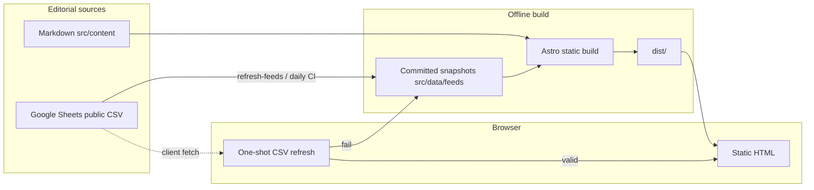

# Technical architecture

Production implementation of the School of Tomorrow’s AI institutional website.

- **URL:** https://schoolai.linalopes.info/  
- **Branch:** `main`  
- **Release tag (Astro cutover):** `v2.0.0`  
- **Reference feature set:** through `c523a15` (Research Wishlist)

## Stack

| Layer | Choice |
|---|---|
| Framework | Astro **7.4.13** static output |
| Language | TypeScript |
| Styling | Native CSS + SchoolAI design tokens |
| Typography | Space Grotesk, Inter, Courier Prime |
| Editorial | Markdown content collections under `src/content/` |
| Feeds | Six Google Sheets CSV feeds → validated JSON snapshots |
| Hosting | GitHub Pages via GitHub Actions |
| Domain | `schoolai.linalopes.info` (HTTPS) |

No React, Tailwind, CMS, database or Stripe SDK. Formspree remains for the newsletter. The existing Three.js atelier tour is preserved under `public/space3d.html`.

## Architecture diagram



## Source layout

```text
src/
  components/     # Presentation (home, editorial, wishlist, support, navigation)
  layouts/        # BaseLayout, EditorialLayout
  pages/          # File-based routes
  content/        # Markdown collections (pages, gallery, support, site)
  content.config.ts
  lib/sheets/     # CSV parse, adapters, snapshots, HTML render helpers
  lib/content.ts  # Markdown loaders and CTA helpers
  data/           # site.ts, navigation.ts (not narrative copy)
  styles/         # tokens, typography, global
  scripts/        # Client bootstrap (nav, feeds, newsletter)
public/           # Remaining legacy HTML (Room for Interaction, Pepper’s Ghost, 3D tour), CNAME, QR assets, robots, sitemap
scripts/          # refresh-feeds.ts, flatten-html-routes.mjs (legacy `.html` URL emit)
.github/workflows/
docs/
```

## Editorial separation

- **Markdown** — institutional copy, CTAs, SEO, rental rates, payments, footer, location, wishlist labels, Arduino Day 2026 event page.  
- **Sheets** — hero, events, archive, workstations, contributors, wishlist **records**.  
- **Astro / TypeScript** — presentation and validation only. Do not hardcode editable copy.

### Legacy `.html` Astro routes

`/arduino-day-2026.html` is generated from Markdown + Astro (`src/pages/arduino-day-2026.astro`), then flattened by `scripts/flatten-html-routes.mjs` so the public URL stays a root-level `.html` file (Programme sheet links and sitemap unchanged). Remaining standalone HTML under `public/` is intentionally untouched.

## Feeds

Shared pipeline: fetch CSV → parse (`src/lib/sheets/csv.ts`) → typed adapter → filter/sort → atomic snapshot write → SSR markup → optional client refresh with last-known-good DOM.

Details: [Feed resilience](feed-resilience.md) · [Google Sheets reference](../editorial/google-sheets.md)

## Design system

Tokens in `src/styles/tokens.css`: deep purple `#22113E`, gray green `#CAD8D8`, pink `#EA7DFF`, turquoise `#08F2DB`, white, magenta `#A21CAF`. Brand kit: https://github.com/linalopes/SchoolAI-brand-kit.

Preserve split hero, footer composition and established spacing. Prefer WCAG AA contrast; automated tests do not certify full compliance.

## Media

External public HTTPS URLs for editorial photographs. Authorised Git exceptions: `public/imgs/contact-twint.png`, `public/imgs/stripe.png`, plus existing brand/legacy assets. See [Media policy](../editorial/media-policy.md).

## Deployment

Offline builds read committed snapshots only. Production deploy never calls Google Sheets. See [Deployment](deployment.md).

## Related

- [Information architecture](../strategy/information-architecture.md)  
- [Testing](testing.md)  
- [AGENTS.md](../../AGENTS.md)  
